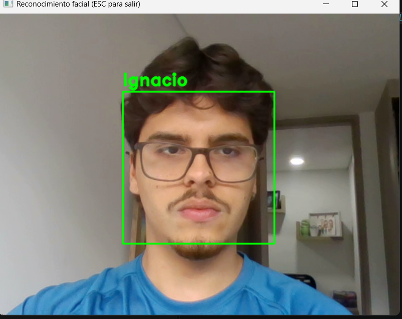
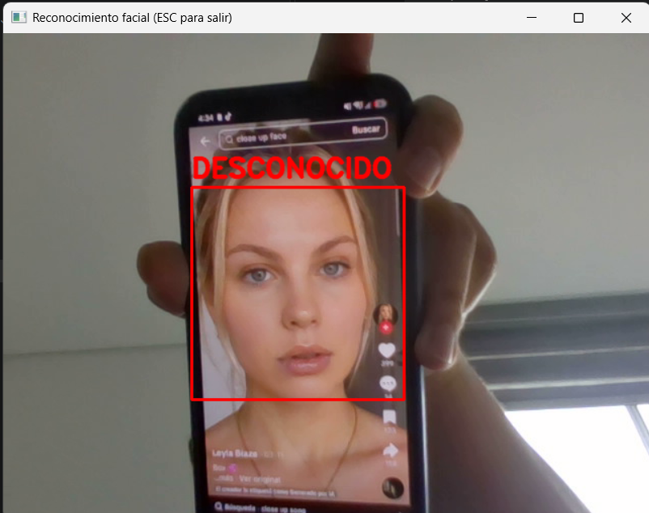

# Reconocimiento facial — solo Ignacio, el resto DESCONOCIDO

| Rostro propio | Rostro ajeno |
|:---:|:---:|
|  |  |
| Verde: `label == Ignacio` y distancia bajo el umbral | Rojo: cualquier otro caso |

Video referencia: https://github.com/GabySol/OmesTutorials2020/tree/master/6%20RECONOCIMIENTO%20FACIAL
